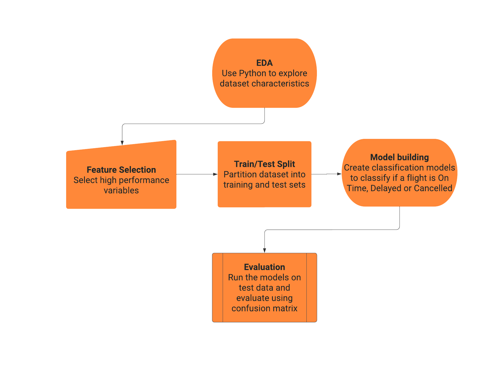

# Flight Status Prediction

An academic group project comparing machine learning models for classifying flights as on time, delayed, or cancelled. This repository summarizes the methods and reported findings of the Group 3 project dated May 2, 2023.

[View the portfolio project](https://shetty21.github.io/#/projects/flight-status-prediction)

## Business question

Can flight records help predict delays and cancellations so airlines can better anticipate operational disruption?

## Dataset

The presentation describes a Kaggle flight dataset for 2022 containing approximately 4 million rows and 61 columns, with a CSV size of 1.42 GB. Example fields include scheduled departure and arrival times, flight number, origin airport, distance, and airtime.

The dataset and its exact Kaggle download URL are not included in the submitted materials. The presentation describes excluding fields unavailable at prediction time, but the final feature list is not provided here.

## Approach

1. Explore the data and select relevant numerical features.
2. Create a three-class target: `0` = on time, `1` = delayed, `2` = cancelled.
3. Exclude fields that would be unavailable when making a prediction.
4. Use the documented 70/30 training and test split.
5. Compare Decision Tree, Random Forest, Multinomial Naive Bayes, and an artificial neural network using accuracy, precision, and recall.

The presentation describes Python for exploratory analysis. It also describes an ANN with 160 input nodes, a hidden layer of 16 neurons, three outputs, ReLU activation, and 100 epochs. Cross-validation appears as a proposed addition on the algorithm slide, so this repository does not claim it was completed.

## Reported findings

- Random Forest performed best among the compared models, with the presentation reporting approximately **92% accuracy, precision, and recall**.
- The team identified cancellation prediction as an important operational priority.
- The presentation highlights missing values, dataset reliability, coverage limited to 2022, and hardware constraints as limitations.

These are results reported in the original presentation. They have not been independently reproduced for this repository. The deck does not document the averaging method for precision and recall, class-level metrics, or enough evaluation detail to establish deployment performance.

## Interpretation

The reported results support Random Forest as a candidate for further investigation. Before operational use, the analysis would need reproducible code, an explicit feature-availability audit, class-level cancellation metrics, and evaluation on later time periods. Overall accuracy alone does not establish how well the model predicts cancellations.

## Repository contents

| File | Purpose |
| --- | --- |
| [Modelling workflow](assets/modelling-workflow.png) | Original workflow figure extracted from slide 4 |

## Attribution and reproducibility

This is a group project, presented here as part of Abhidith Shetty's portfolio. The original deck credits **Group 3** and does not list individual contributors or their responsibilities. No individual contribution breakdown is asserted here.

This repository contains a project summary and workflow figure. The original PowerPoint remains private and is not distributed here. Training code, notebooks, model artifacts, and raw data were not supplied and are not included. It is not an executable model release.
